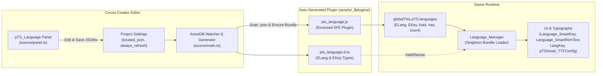

# pTS-Language

A multi-language **localization and typography** extension for **Cocos Creator 3.8.8+**, featuring a dockable visual dictionary editor (`pTS_Language`), automatic plugin & TypeScript `.d.ts` code generation, bundle-backed JSON loading, reactive UI text components, and per-style TTF font management.

---

## Features

- **Visual Localization Panel (`pTS_Language`)**: Manage translation keys and language files directly inside Cocos Creator — add/remove keys and languages, search/filter entries, toggle **Always Refresh** or **Lazy Load**, and save all `.json` dictionaries in one click.
- **Automatic Plugin & Type Generation**: Scans `.json` files in your configured `located_json` folder and generates `assets/_$plugins/pts_language.js` and `assets/_$plugins/pts_language.d.ts` (git-ignored via `assets/_$plugins/*`) for compile-time IntelliSense on `pTS.languages.ELang` and `pTS.languages.EKey`.
- **Safe Enclosed Plugin Wrapper**: Generated `pts_language.js` uses a cross-environment IIFE (`globalThis` / `window` / `self` / `this`) and automatically configures its Cocos `.meta` with `executionScope: "enclosed"` and `simulateGlobals: ["window", "self", "global"]` across Web, Native, Editor, Preview, and MiniGame targets.
- **Automatic Asset Bundle Setup**: Ensures the configured JSON directory (or one of its parent folders) is flagged as a Cocos Asset Bundle (`isBundle: true`) so `Language_Manager` can load language dictionaries at runtime.
- **Flexible Runtime Formatting**: `Language_Manager` supports casing modes (`Normal`, `Pascal`, `Upper`, `Lower`), `prefix`/`suffix`, nested string/key `replacer` chains, sync/async post-processing `handler`s, and direct `Label`/`RichText` target assignment.
- **Reactive UI & Typography Components**: Includes `LangKey`, `Language_SmartKey` (for `cc.Label`), `Language_SmartRichText` (extends `cc.RichText`), and TTF font registries (`pTSAsset_TTFConfig` & `Config_GlobalTTF`) organized by `Enums_EFontType` and `Enums_EFontExtra`.

---

## Requirements

- **Cocos Creator**: `>= 3.8.8`
- **Peer Extension (Hard Dependency)**: `pts-core` (provides the global `pTS` namespace, `pClass`, `pDriver`, `pArray`, `pString`, `pEngine`, `pLazy`, `pTSAsset`, and `pTSAsset_Data`)

---

## Installation & Setup

1. Copy the `pts-language` folder into your project's `extensions/` directory (alongside `pts-core`):
   ```text
   <your-project>/extensions/pts-language
   ```
2. Build the extension (if `dist/` is not already compiled):
   ```bash
   cd extensions/pts-language
   npm install
   npm run build
   ```
3. Enable **pts-language** in Cocos Creator via **Extension → Extension Manager**.
4. Configure your language JSON folder in **Project → Project Settings → PTS Language** (or inside the **pTS_Language** panel via **Extension → pTS-Language → Open Panel**).

---

## Architecture Overview



---

## Using the `pTS_Language` Panel & Project Settings

### 1. Project Settings (`Project → Project Settings → PTS Language`)

| Setting / Action | Profile Key | Description |
| :--- | :--- | :--- |
| **JSON Folder** | `located_json` | Directory inside `project://assets/` containing per-language `.json` files (e.g., `en.json`, `vi.json`). Must stay inside the project path. |
| **Always Refresh** | `always_refresh` | When enabled (default: `true`), listens to AssetDB events (`ready`, `asset-add`, `asset-change`, `asset-delete`) for `.json` files and auto-regenerates plugin files. |
| **Open Language Panel** | `btn_open_panel` | Opens the dockable `pTS_Language` editor panel. |
| **Force Generate** | `btn_force_generate` | Immediately re-scans `located_json`, ensures bundle metadata, and regenerates `pts_language.js` & `pts_language.d.ts`. |

### 2. Dockable Panel (`Extension → pTS-Language → Open Panel`)

- **Top Settings Bar**: Pick the **JSON Folder**, toggle **Always Refresh**, and toggle **Lazy Load**.
- **Actions**:
  - **+ Add Key**: Adds a new translation key across all language JSON files.
  - **+ Add Lang**: Creates a new language `.json` file (e.g., `fr`, `ja`, `ko`, `de`).
  - **Remove Mode**: Select multiple keys for batch deletion.
  - **Refresh**: Reloads keys and languages from disk.
  - **Save All**: Persists edits to disk and refreshes generated typings.
- **Search & Stats**: Filter keys in real time with live key/language count pills and status indicator.

### 3. Translation JSON Format

Each `.json` filename in `located_json` becomes a member of `pTS.languages.ELang` (e.g., `en.json` → `"en"`, `vi.json` → `"vi"`). Only keys whose values are `string` or `string[]` are indexed into `pTS.languages.EKey`:

```json
{
    "btn_play": "Play Game",
    "greeting": "Hello {name}!"
}
```

> **Note:** `assets/_$plugins/*` is git-ignored because `pts_language.js` and `pts_language.d.ts` are generated per project from `located_json`.

---

## Runtime Usage

### Global `pTS.languages` API

The generated plugin attaches `pTS.languages` globally and exposes ambient TypeScript types:

```ts
// Strongly-typed language & key unions from pts_language.d.ts
const lang: pTS.languages.ELang = "en";
const key: pTS.languages.EKey = "btn_play";

// Check whether a language code exists
if (pTS.languages.has("vi")) {
    console.log("Total languages:", pTS.languages.count);
}

// Iterate all relative JSON asset paths inside the resolved bundle (pTS.languages.path)
pTS.languages.load((subPath) => {
    console.log("Language asset path:", subPath);
});
```

### Using `Language_Manager`

`Language_Manager` is a `@singleton()` class accessed via `instance(Language_Manager)` from `pts-core`. It automatically starts preloading on `DirectorEvent.BEFORE_SCENE_LAUNCH` in preview/runtime builds, and every `get`/`gets`/`sgets` call awaits `load()`.

```ts
import { _decorator, Component, Label } from "cc";
import { instance } from "db://pts-core/scripts/utils/pClass";
import { Language_Manager } from "db://pts-language/scripts/Components/Language.Manager";

const { ccclass, property } = _decorator;

@ccclass("MenuUI")
export class MenuUI extends Component {
    @property(Label)
    titleLabel: Label = null!;

    async start() {
        const langMgr = instance(Language_Manager);

        // 1. Simple lookup (defaults to EMode.Pascal)
        const playText = await langMgr.get("btn_play");

        // 2. Lookup with casing mode, prefix/suffix, replacers, and direct Label target
        await langMgr.get({
            key: "greeting",
            mode: Language_Manager.EMode.Normal,
            prefix: "[ ",
            suffix: " ]",
            replacer: [{ find: "{name}", replacer: "Hero" }],
            targets: this.titleLabel,
        });

        // 3. Batch lookup as a key -> string map
        const dict = await langMgr.gets(["btn_play", "greeting"]);

        // 4. Switch active language (validated via pTS.languages.has)
        langMgr.change("vi");
    }
}
```

### UI Components & Font Configs

- **`Language_SmartKey`** (`Add Component → pts-language/Language/SmartKey`):
  - Requires `cc.Label` (`hooker` auto-binds to the node's `Label`).
  - Configure `keys: LangKey[]` (each with `key`, `mode`, `prefix`, `suffix`, and reactive `params` backed by `JsonAsset` or `pTSAsset_Data`), joined with `space`.
  - Automatically applies a `TTFFont` from `pTSAsset_TTFConfig` using `font` (`Enums_EFontType`) and `extra` (`Enums_EFontExtra`).
- **`Language_SmartRichText`**:
  - Extends `cc.RichText` with the same `keys: LangKey[]`, `space`, `isUpdateKey`, and `pTSAsset_TTFConfig` font binding (`tfont`, `extra`).
- **`pTSAsset_TTFConfig`** (`Create → pTSAsset → Language/TTFConfig`) & **`Config_GlobalTTF`** (`pts-language/Config/GlobalTTF`):
  - Map `default` and per-country (`pTS.languages.ELang`) font tables keyed by `Enums_EFontType` (`Regular`, `Bold`, `Italic`, `Light`, `Medium`, `Thin`) and `Enums_EFontExtra` (`None`, `Outline`, `Extra`, `ExtraOutline`).

---

## API & Component Reference

### `pTS.languages` (Auto-Generated Global)

| Member | Type / Signature | Description |
| :--- | :--- | :--- |
| `ELang` | `Record<string, string>` & union type | Discovered language codes derived from `.json` filenames. |
| `EKey` | `Record<string, string>` & union type | Discovered translation keys (values of type `string` or `string[]`). |
| `path` | `string` | Resolved Cocos Asset Bundle name containing the language JSONs. |
| `count` | `number` | Number of discovered language files. |
| `has(key)` | `(key: string) => boolean` | Returns `true` if `key` is a registered language in `ELang`. |
| `load(cb)` | `(cb: (subPath: string) => void) => void` | Invokes `cb` with each language's relative path inside the bundle. |

### `Language_Manager`

| Member / Method | Description |
| :--- | :--- |
| `country` | Currently active language code (`pTS.languages.ELang`, default `"en"`). |
| `driver` | `pDriver.Handler` event bus (`onCountryChanged`). |
| `load()` | Loads all language `JsonAsset`s from `pTS.languages.path` bundle (cached promise). |
| `get(opt)` | Resolves a key or options object (`key`, `mode`, `prefix`, `suffix`, `replacer`, `handler`, `sync`, `targets`). |
| `gets(opt, ...opts)` | Resolves multiple keys/options and returns `Record<pTS.languages.EKey, string>`. |
| `sgets(opt, ...opts)` | Resolves multiple keys/options into a concatenated string. |
| `change(country)` | Updates the active language if `pTS.languages.has(country)` is `true`. |
| `Language_Manager.EMode` | Text casing enum: `Normal`, `Pascal`, `Upper`, `Lower`. |

### Scripts & Components

| Class | File | Role |
| :--- | :--- | :--- |
| `Language_Manager` | `assets/scripts/Components/Language.Manager.ts` | Singleton bundle loader, formatter, and language state holder. |
| `LangKey` | `assets/scripts/Components/Language.LangKey.ts` | Serializable key + casing + reactive `Param` (`JsonAsset` / `pTSAsset_Data`) helper. |
| `Language_SmartKey` | `assets/scripts/Components/Language.SmartKey.ts` | `cc.Label` localization & TTF font binder component. |
| `Language_SmartRichText` | `assets/scripts/Components/Language.SmartRichText.ts` | Localized `cc.RichText` subclass with TTF font binding. |
| `pTSAsset_TTFConfig` | `assets/scripts/pTSAssets/pTSAsset.TTFConfig.ts` | Singleton `pTSAsset` mapping font types/extras to `TTFFont` assets. |
| `Config_GlobalTTF` | `assets/scripts/Config/Config.GlobalTTF.ts` | `Config_Smart` component variant for global TTF font mapping. |
| `Enums_EFontType` / `Enums_EFontExtra` | `assets/scripts/Enums/Enums.FontType.ts` | Font weight/style and outline/extra enums. |

---

## Directory Structure

```text
extensions/pts-language/
├── assets/
│   ├── _$plugins/                  # Auto-generated pts_language.js & pts_language.d.ts (git-ignored)
│   └── scripts/
│       ├── Components/
│       │   ├── Language.LangKey.ts
│       │   ├── Language.Manager.ts
│       │   ├── Language.SmartKey.ts
│       │   └── Language.SmartRichText.ts
│       ├── Config/
│       │   └── Config.GlobalTTF.ts
│       ├── Enums/
│       │   └── Enums.FontType.ts
│       └── pTSAssets/
│           └── pTSAsset.TTFConfig.ts
├── i18n/                           # Extension localization (en, zh)
├── source/
│   ├── main.ts                     # Lifecycle, dependency check, bundle ensure, plugin/d.ts codegen
│   └── panel.ts                    # Dockable pTS_Language editor panel
├── bootstrap.js                    # Extension entry point
└── package.json                    # Cocos Creator v2 extension manifest
```

---

## Development

```bash
cd extensions/pts-language

# One-time build
npm run build

# Watch mode during development
npm run watch
```
